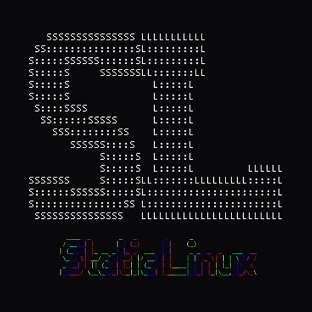

# Static Linux
**by Static Forge**

> Fast. Private. Yours.

**Página del proyecto:** [staticforge.me/linux](https://staticforge.me/linux/)

Distribución basada en Arch Linux con detección automática de hardware
(`sl-detect`), entornos de escritorio adaptativos según el equipo detectado,
y privacidad por defecto — cero telemetría, siempre.

## Estado

Fase 1 (base mínima arrancable) completa, validada en un
[Packard Bell iMedia S2883](docs/wiki/hardware/imedia-s2883.md) (Celeron
J1900, 2013, rescatado de la basura). Fase 2 (entornos + `sl-detect`) en
curso — ver `AGENTS.md` para el detalle fase a fase.

Construido hasta ahora:

- **`sl-detect`** — detección de hardware completa (GPU vía PCI y, para
  placas ARM, vía device-tree), 38 tests.
- **`sl-ctl`** — gestión post-instalación: `detect`/`info`/`privacy`/`tweaks`
  funcionan; `update`/`snapshot`/`mirror`/`flavor` en desarrollo.
- **`sl-welcome`** — app de primer arranque (GTK4/libadwaita): apariencia,
  privacidad, catálogo de ~56 apps extra.
- **4 entornos**: XFCE temático (el único probado en hardware real),
  Openbox minimal, Hyprland+Astal (full/lite).
- **3 perfiles de privacidad** y **8 sabores** (Gaming, Development,
  Cybersecurity...), todos reversibles.
- **Sistema de acentos**: 10 colores, un solo `apply.sh` que themea
  fastfetch/GTK/xfwm4/terminal/greeter/wallpaper a la vez.
- **Instalador Calamares**: secuencia completa (`settings.conf`), aunque
  sin probar todavía en un Calamares real.
- **`staticlinux-base`**: el PKGBUILD que lleva todo lo anterior a
  `/usr/lib/static-linux/` en una instalación real.

## Arquitectura

- Base: Arch Linux
- Init: systemd
- Instalador: Calamares + sl-detect (live pacman, sin unpackfs)
- Entornos: Hyprland+Astal (full/lite) / XFCE temático / Openbox minimal
- Privacidad: 3 perfiles configurables, reversibles
- Sistemas de archivos: EXT4 (HDD/RAM baja) / BTRFS (SSD + ≥4 GB) / F2FS (eMMC)
- Boot: GRUB (Secure Boot no soportado)

## Documentación

- **[Wiki](https://kcrooty.github.io/static-linux/)** — guía de instalación,
  cada herramienta, requisitos de hardware, FAQ.
- [`docs/wiki/estructura.md`](docs/wiki/estructura.md) — qué hay en cada
  carpeta del repo.
- [`AGENTS.md`](AGENTS.md) — contexto de proyecto y estado por fases.
- [`CONTRIBUTING.md`](CONTRIBUTING.md) — cómo contribuir y dónde hace falta
  más ayuda ahora mismo.

## Repos

- Principal: `KCRooty/static-linux`
- Issues, releases: GitHub
