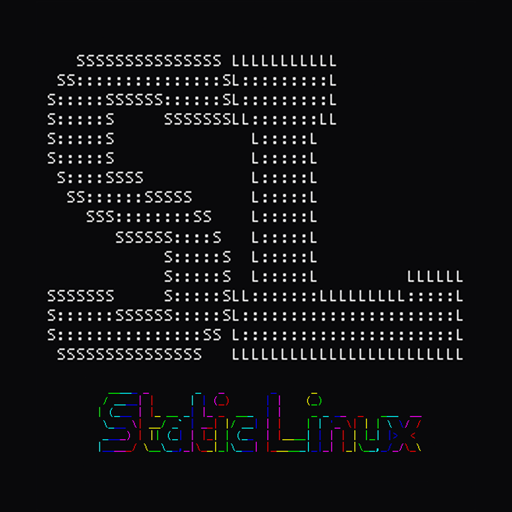
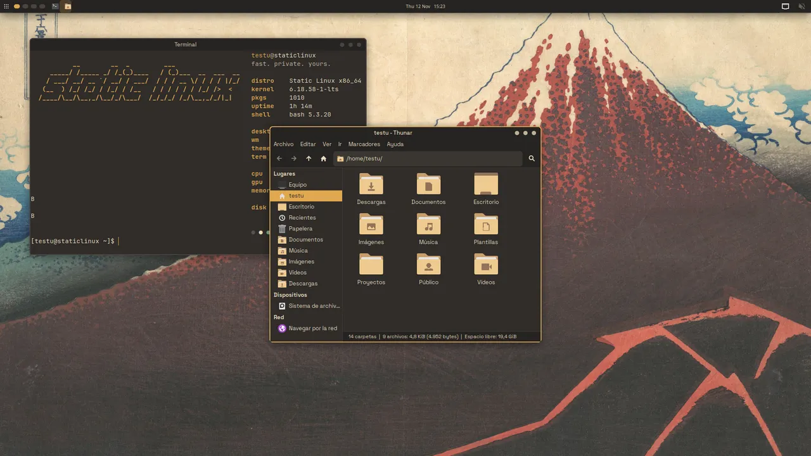
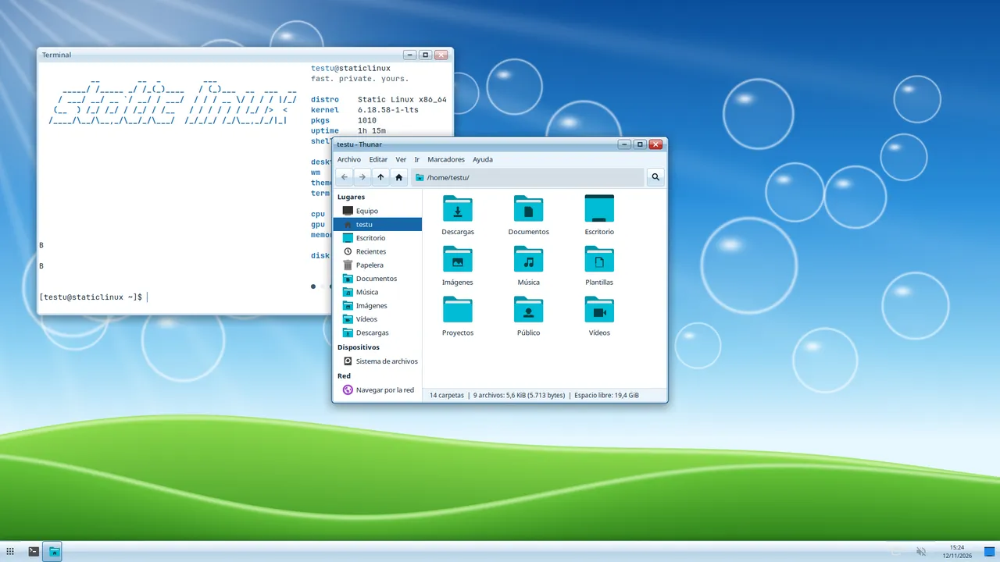
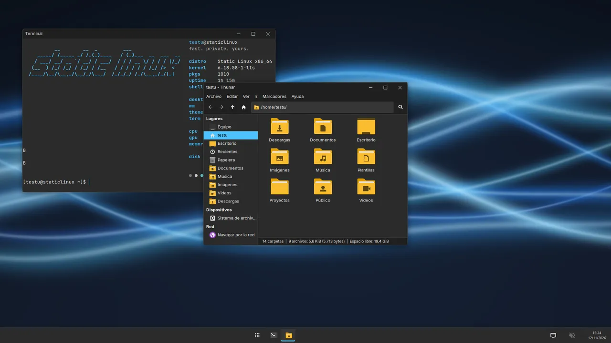

# Static Linux
**by Static Forge**

> Fast. Private. Yours.

**Página del proyecto:** [staticforge.me/linux](https://staticforge.me/linux/) ·
**Wiki:** [staticforge.me/static-linux](https://staticforge.me/static-linux/) ·
**Blog:** [staticforge.me/linux/blog](https://staticforge.me/linux/blog/)

Distribución basada en Arch Linux con detección automática de hardware
(`sl-detect`), entornos de escritorio que se ajustan al equipo, temas que
pintan todo el sistema con la paleta de su fondo y privacidad por defecto:
cero telemetría, siempre.

## Temas y estilos

Un tema es un fondo y la paleta que sale de él; un estilo es la forma del
escritorio. Ocho temas y tres estilos, elegibles en el instalador, en la
bienvenida o con `sl-ctl theme`. Detalle en la
[wiki](https://staticforge.me/static-linux/temas/).

| Aero (estilo aero) | Ventanas (estilo ventanas) |
|---|---|
|  |  |

| Tema | Modo | Estilo |
|---|---|---|
| **Ámbar** (por defecto) · Papel · Nórdico · Bosque · Sakura · Violeta | oscuro, salvo Papel | minimal |
| **Aero** | claro | aero: brillo, botones cápsula, barra abajo |
| **Ventanas** | oscuro | ventanas: plana, apps centradas en la barra |

## Estado

Fases 1 y 2 cerradas: la ISO se construye, arranca en UEFI e instala de
principio a fin (probada en QEMU/KVM). Fase 3 en curso: el aspecto nuevo y
probar el resto de escritorios. **No hay ISO pública todavía**; se construye
desde este repositorio (ver [`iso/README.md`](iso/README.md)).

Funciona hoy:

- **`sl-detect`**: detección de hardware (GPU vía PCI y, en ARM, vía
  device-tree); recomienda entorno, sistema de archivos y kernel.
- **Instalador Calamares** en español y a pantalla completa: entorno, tema,
  sabores, privacidad y catálogo de apps.
- **Temas** en XFCE con `sl-theme`: GTK 3/4, ventanas, panel, iconos,
  terminal, fastfetch y fondo.
- **`sl-welcome`** (GTK4/libadwaita): resumen, selector de temas,
  privacidad y catálogo, con una sección de apps de Static Forge.
- **`sl-ctl`**: `detect`, `info`, `privacy`, `theme` y `tweaks` con backup;
  `update`, `snapshot`, `mirror` y `flavor` en desarrollo.
- **5 entornos** empaquetados: XFCE temático, KDE Plasma, Hyprland+Astal
  (full/lite) y Openbox minimal.
- **DNS cifrado** por dnscrypt-proxy desde el primer arranque; 3 perfiles de
  privacidad y 8 sabores, todos reversibles.

Pendiente: temas en KDE, Hyprland, Openbox, LightDM, Plymouth y GRUB; sesión
en vivo con escritorio; ISO offline sin red; BIOS antigua; btrfs y LUKS. La
lista de cambios está en [`CHANGELOG.md`](CHANGELOG.md).

## Arquitectura

- Base: Arch Linux, systemd
- Instalador: Calamares + sl-detect (live pacman, sin unpackfs)
- Entornos: XFCE temático / KDE Plasma / Hyprland+Astal (full/lite) / Openbox minimal
- Aspecto: temas (fondo + paleta) y estilos minimal / aero / ventanas, ver [`DESIGN.md`](DESIGN.md)
- Privacidad: 3 perfiles configurables, reversibles
- Sistemas de archivos: EXT4 (HDD/RAM baja) / BTRFS (SSD + ≥4 GB) / F2FS (eMMC)
- Boot: GRUB (Secure Boot no soportado)

## Documentación

- **[Wiki](https://staticforge.me/static-linux/)**: instalación, cada
  herramienta, temas, requisitos de hardware, FAQ.
- **[Blog](https://staticforge.me/linux/blog/)**: notas de desarrollo de
  cada versión ([RSS](https://staticforge.me/linux/blog/feed.xml)).
- [`CHANGELOG.md`](CHANGELOG.md): cambios, arreglos y problemas conocidos.
- [`DESIGN.md`](DESIGN.md): dirección visual.
- [`docs/wiki/estructura.md`](docs/wiki/estructura.md): qué hay en cada carpeta.
- [`docs/PROYECTO.md`](docs/PROYECTO.md): contexto y estado por fases.
- [`CONTRIBUTING.md`](CONTRIBUTING.md): cómo contribuir y dónde hace falta ayuda.

## Contacto

Static Forge · [staticforge@staticforge.me](mailto:staticforge@staticforge.me) ·
issues en GitHub. Licencia GPL-3.0; los fondos llevan su autor y licencia en
`branding/themes/<id>/CREDITS`.
