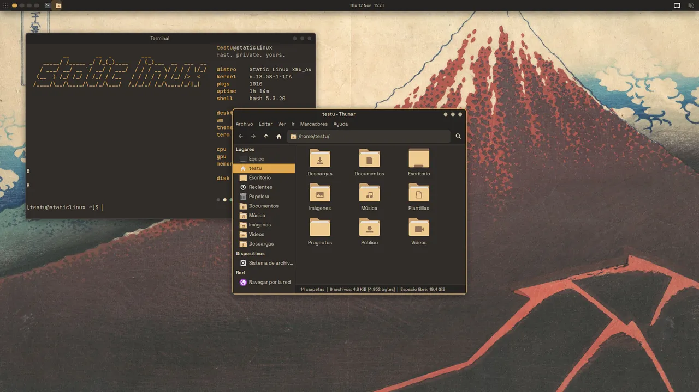

# Novedades

Lo que cambió en cada versión. La lista completa está en
[`CHANGELOG.md`](https://github.com/KCRooty/static-linux/blob/main/CHANGELOG.md)
y las notas largas, con capturas, en el
[blog](https://staticforge.me/linux/blog/) ([RSS](https://staticforge.me/linux/blog/feed.xml)).

## 2026-11-12 · Temas, estilos y el código, abierto

- **Ocho temas** que son fondo + paleta, aplicados por `sl-theme`
  ([Temas y estilos](temas.md)).
- **Tres estilos**: minimal, aero y ventanas.
- Página **Tema** en el instalador, selector en sl-welcome y `sl-ctl theme`.
- Sección **Static Forge** en el catálogo, empezando por KC Downloader.
- Código público y esta wiki en staticforge.me/static-linux.

**Arreglos:** DNS cifrado de verdad por dnscrypt-proxy; copias de seguridad de
`sl-theme` con el dueño correcto.

!!! warning "Problemas conocidos"
    Temas solo en XFCE; LightDM, Plymouth y GRUB sin tema; las apps abiertas
    cambian al reabrirlas; la sesión en vivo no tiene escritorio; Violeta
    lleva un fondo provisional; no hay ISO pública todavía.

## 2026-10-23 · Instalador pulido, KDE Plasma y Hyprland 0.56

KDE Plasma elegible, Hyprland 0.56, instalador en español a pantalla completa
con HiDPI, Brave Origin, tecla Super, códecs y fondos 4K.

## 2026-10-11 · La primera ISO que instala de principio a fin

ISO de 1,7 GB que arranca en UEFI e instala en QEMU/KVM con XFCE, LightDM y
sl-welcome.

## 2026-09-21 · Bienvenida, instalador y más entornos

sl-welcome, Calamares completo, Openbox e Hyprland, `staticlinux-base` y la
wiki.

## 2026-09-10 · Arranca Static Linux

`sl-detect`, XFCE con tema y diez acentos.
