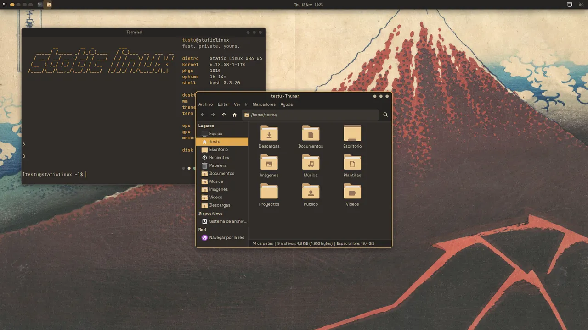
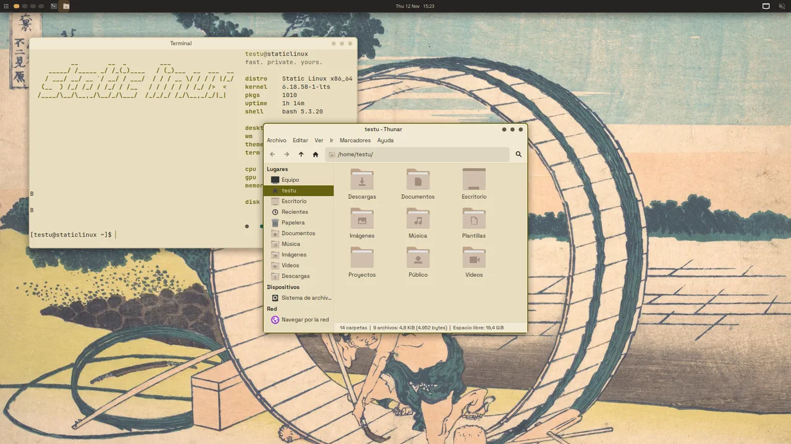
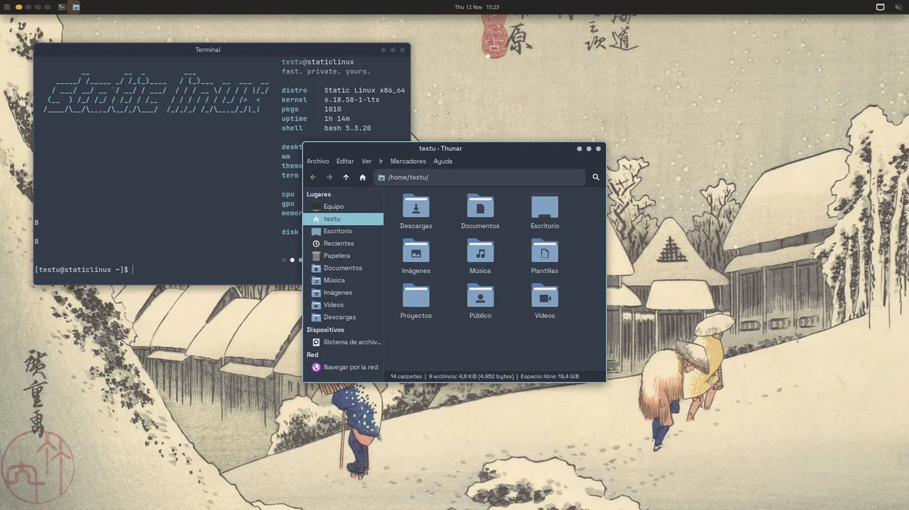
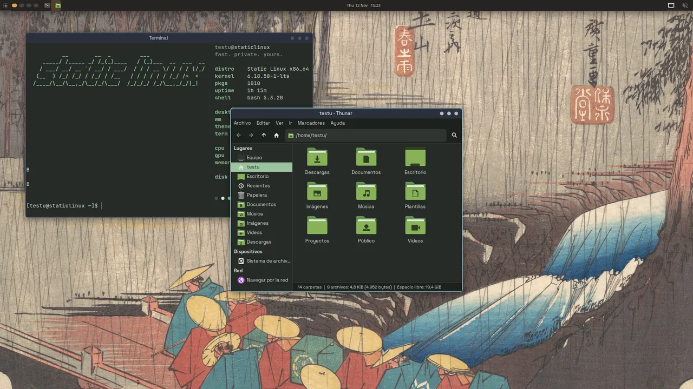
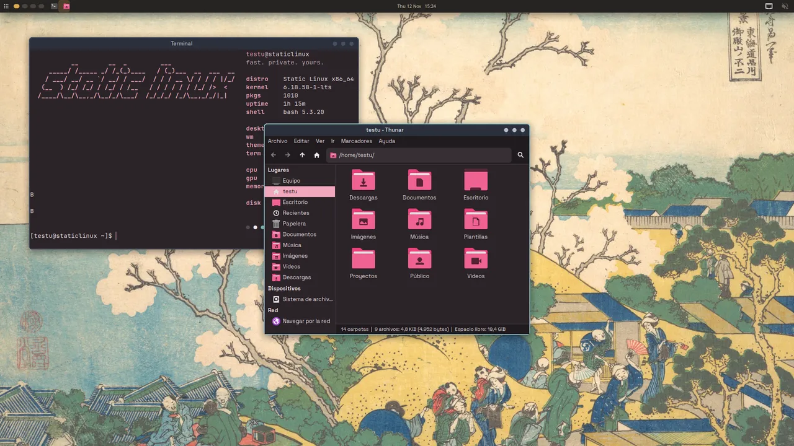
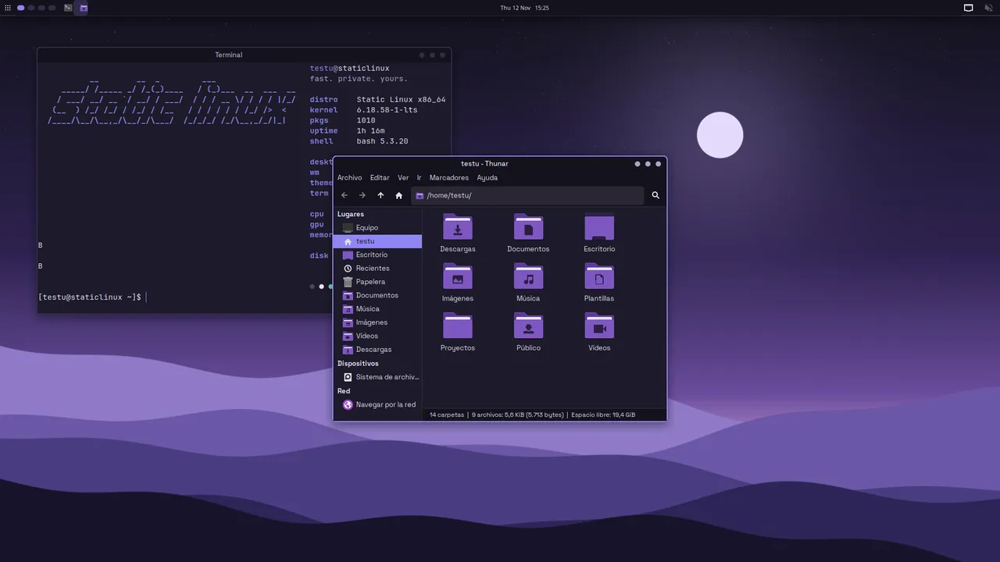
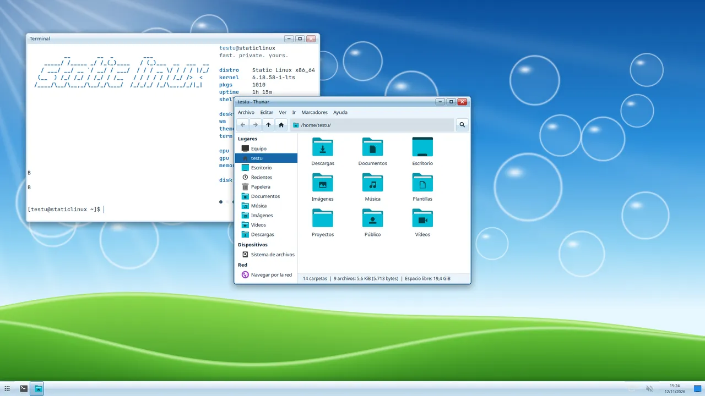
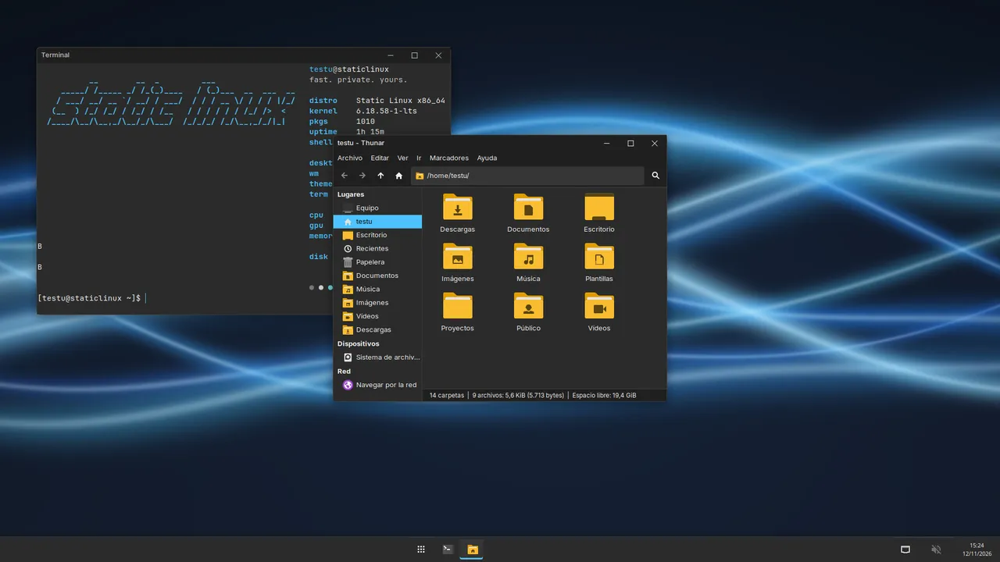
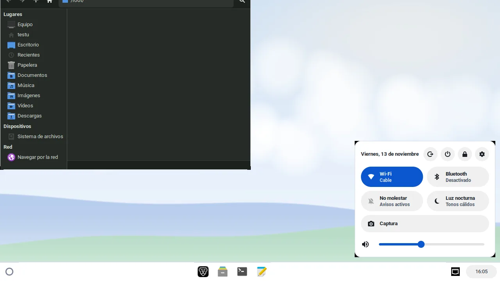

# Temas y estilos

Un **tema** es un fondo de pantalla y la paleta que sale de él. Un **estilo**
es la forma del escritorio: ventanas, barra y controles. Cada tema trae su
estilo; `sl-theme` lo pinta todo a la vez. La dirección visual completa está
en [`DESIGN.md`](https://github.com/KCRooty/static-linux/blob/main/DESIGN.md).

!!! note "Estado (2026-11-12)"
    Los temas llegan a los cuatro entornos (XFCE, KDE Plasma, Hyprland y
    Openbox) y al arranque: menú de GRUB, pantalla de carga (Plymouth) y
    pantalla de inicio de sesión (LightDM o SDDM). Probado en la VM: XFCE,
    Openbox, LightDM, Plymouth y GRUB. KDE e Hyprland están generados y
    revisados, pero falta verlos arrancados en una instalación.

## Los nueve temas

| | Tema | Modo | Estilo | Acento | Fondo |
|---|---|---|---|---|---|
| { width=160 } | **Ámbar** (por defecto) | oscuro | minimal | `#E0A84F` | Hokusai, «Tormenta bajo el Fuji» (CC0) |
| { width=160 } | **Papel** | claro | minimal | `#666211` | Hokusai, «Fujimigahara en Owari» (CC0) |
| { width=160 } | **Nórdico** | oscuro | minimal | `#88C0D0` | Hiroshige, «Nieve al anochecer en Kanbara» (dominio público) |
| { width=160 } | **Bosque** | oscuro | minimal | `#9BC4A0` | Hiroshige, «Lluvia de primavera en Tsuchiyama» (CC0) |
| { width=160 } | **Sakura** | oscuro | minimal | `#F2A7BC` | Hokusai, «El Fuji desde Gotenyama» (CC0) |
| { width=160 } | **Violeta** | oscuro | minimal | `#8F86F2` | provisional, dibujado por código (GPL-3.0) |
| { width=160 } | **Aero** | claro | aero | `#1667A8` | original, dibujado por código (GPL-3.0) |
| { width=160 } | **Ventanas** | oscuro | ventanas | `#4CC2FF` | original, dibujado por código (GPL-3.0) |
| { width=160 } | **Nube** | claro | estante | `#0B57D0` | original, dibujado por código (GPL-3.0) |

Cada fondo lleva autor, licencia y cambios en `branding/themes/<id>/CREDITS`.
Los escaneos son de The Metropolitan Museum of Art (Open Access).

## Los cuatro estilos

| Estilo | Ventanas | Barra | Fuente |
|---|---|---|---|
| **minimal** | borde de 2 px, botones como tres puntos | arriba, 30 px, escritorios como puntos y reloj al centro | Space Grotesk |
| **aero** | barra de título con brillo, botones cápsula, cerrar en rojo | abajo, 40 px con brillo; reloj con fecha y "mostrar escritorio" | Noto Sans |
| **ventanas** | plana, botones de 46 px ─ □ ✕ | abajo, 48 px, apps al centro, la activa subrayada | Inter |
| **estante** | alta y plana, esquinas de 12 px, círculo neutro al pasar el ratón (cerrar no se pone rojo) | abajo, 48 px: lanzador redondo con búsqueda y apps en cuadrícula, dock centrado, píldora de hora que abre los ajustes rápidos (`sl-quick`); avisos abajo a la derecha, escritorio sin iconos, Alt+[ / Alt+] / Alt+= para ajustar ventanas | Roboto |

<div class="grid" markdown>


</div>

El brillo de aero son degradados sobre color sólido: ningún estilo usa
transparencia. La barra solo se reescribe cuando **cambia el estilo**; un
cambio de paleta dentro del mismo estilo respeta los retoques que hayas hecho
en tu panel.

## Dónde se elige

- **Instalador:** página **Tema**, con capturas reales de los ocho.
- **sl-welcome:** pestaña **Apariencia**.
- **Terminal:**

```bash
sl-ctl theme --list        # temas y cuál está activo
sl-ctl theme aero          # aplicar al usuario actual
sudo sl-ctl theme aero     # y además inicio de sesión, GRUB y arranque
sl-theme --current         # id del tema activo
sudo sl-theme ambar --skel # pintar /etc/skel (build de la ISO)
sudo sl-theme ambar --system  # solo inicio de sesión, GRUB y Plymouth
```

## Qué toca `sl-theme`

Todo sale de `branding/themes/<id>/theme.conf` y de las plantillas de
`branding/themes/templates/` (la lista exacta está en `templates/MANIFEST`):

- GTK 3 y 4 (`~/.config/gtk-{3,4}.0/gtk.css`) sobre adw-gtk3: las apps
  libadwaita, sl-welcome incluida, heredan la paleta.
- Tema de ventanas xfwm4 `StaticLinux`, dibujado píxel a píxel con antialias
  por `xfwm4.py` según el estilo.
- Iconos Papirus con carpetas del color del tema (`icons.py`).
- xsettings (tema, fuente, iconos, botones de ventana) y el panel de XFCE.
- Terminal (xfce4-terminal, kitty, LXTerminal y Konsole), fastfetch y cava.
- El fondo de pantalla.

Cada fila de `MANIFEST` puede nombrar un programa: ese archivo solo se
escribe si el programa está instalado. Así una sola orden pinta el entorno
que tengas:

| Entorno | Qué recibe |
|---|---|
| XFCE | xfwm4, panel, xfce4-terminal, fondo por xfconf |
| KDE Plasma | esquema de color `StaticLinux` (también dentro de `kdeglobals`), Konsole, fondo |
| Hyprland | bordes y redondeo (`~/.config/hypr/theme.lua`), hyprpaper, hyprlock, barra de Astal, dunst |
| Openbox | tema de ventanas `StaticLinux`, tint2, jgmenu, dunst, LXTerminal, fondo con feh |

Con `--system` (como root) pinta lo que es de toda la máquina, con copia de
lo que sustituye en `/var/backups/static-linux/theme/<fecha>/`:

- **Inicio de sesión:** LightDM con el fondo del tema y un tema GTK propio
  (`StaticLinux-Greeter`); en SDDM, el fondo de Breeze.
- **GRUB:** tema en `/boot/grub/themes/static-linux` con el fondo atenuado,
  menú del color del tema y fuentes Space Grotesk y Outfit.
- **Plymouth:** fondo atenuado, la marca de Static Forge, barra del color de
  acento y la petición de contraseña de LUKS. Regenera el initramfs.

Tus reglas propias van en `~/.config/gtk-{3,4}.0/gtk-custom.css`, que
`sl-theme` crea vacío y nunca sobrescribe. Todo lo que sobrescribe se copia
antes a `~/.local/state/static-linux/theme-backup/<fecha>/`.

Con la sesión abierta, `sl-theme` avisa a lo que esté corriendo: el panel
de XFCE se reconstruye al cambiar de estilo, Openbox, tint2 y dunst recargan,
Hyprland recarga y relanza hyprpaper, y Plasma aplica el esquema y el fondo.
Las apps que ya estaban abiertas cambian al reabrirlas.

## Hacer un tema

```ini
# branding/themes/<id>/theme.conf
name=Mi tema
mode=dark            # dark | light
style=minimal        # minimal | aero | ventanas | estante (opcional, minimal si falta)
font_ui=Inter        # opcional, Space Grotesk si falta
folders=yellow       # opcional, color de carpetas de Papirus
bg=262321            # fondo de ventana
surface=302C29       # campos, terminal, filas
line=4A443F          # bordes
text=EBDDBF
text_dim=BFB29A
accent=E0A84F
accent_fg=262321     # texto sobre el acento
danger=EB6F68
warning=D8A657
term=...             # 8 colores de terminal
term_bright=...      # 8 colores brillantes
```

Al lado, `wallpaper.jpg` (3840×2160), `preview.jpg` (320×180) y `CREDITS`.
`branding/themes/check.py` comprueba el contraste AA de texto y terminal: un
tema que falla no entra en la ISO. Los fondos originales se generan con
`branding/themes/gen_wallpaper.py`.

## Identidad de marca

```
Void:         #0B0C10  (fondo principal)
Signal Green: #00C8A0  (acento de marca)
Amber:        #F5A623  (ISO offline, avisos)
```

Tipografías (SIL OFL): **Outfit 700** para titulares, GRUB y logotipo;
**Space Grotesk** para interfaz; **JetBrains Mono** para terminal y código.

## Los acentos de antes

`branding/accents/apply.sh` y sus diez acentos siguen en el repo para
`sl-ctl accent` y el resumen de sl-welcome, pero ni el instalador ni los
entornos los usan ya: todo pasa por `sl-theme`.
